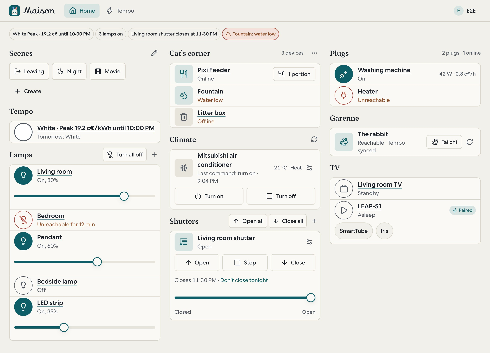

#  Maison

A self-hosted home dashboard in one Rust binary, small enough for the hardware nobody wants
any more.



Maison drives every device of a house on its own network, serves the web app that controls
them, and needs nothing else: no cloud account, no container, no database, no broker between
it and the radios. It ran on a 2012 Raspberry Pi 1; it now runs on an ISP's
discarded set-top box.

## What it drives

| | |
|---|---|
| Lamps | Zigbee through a native EZSP driver (no zigbee2mqtt), Hue over Bluetooth, the Hue dimmer |
| Shutters | Matter, commissioned by Maison itself; they follow the sun, and one evening can be skipped |
| Plugs | Meross over local HTTP, with power and cost |
| Climate | a Mitsubishi air conditioner over infrared, its frames encoded from the unit's grammar |
| TV | a Philips set and an Android TV box (keys, apps, sideloading), and [a home screen of our own](docs/box.md) for the box |
| Cats | Tuya feeder, fountain and litter box over local TCP |
| Energy | EDF Tempo: today's and tomorrow's colours, prices, and [a 7-day forecast](docs/tempo.md) |
| Scenes | named lists of actions across them |
| And | a Nabaztag that wears tomorrow's Tempo colour on its ears |

## How it is made

- **One binary.** Axum and tokio serve the API and a SvelteKit app built to static files. State
  is a handful of JSON files written atomically.
- **Local.** Every device is spoken to on the LAN in its own protocol. The only outside calls
  fetch public data: Tempo, the weather.
- **Passkeys only.** No password exists. People come in by invitation; a machine gets a
  service token; a wall screen is paired by a code. [docs/passkeys.md](docs/passkeys.md)
- **Pushed, not polled.** A change reaches every open page and screen as it happens, over
  server-sent events; polling is the safety net.
- **Said once.** API types, refusal codes, read paces and event names live in one shared crate,
  generated for the web app and compiled into the wall screen.
- **Tested end to end.** Rust unit and integration tests, Vitest for every component,
  Playwright and axe against the real backend.

## Where it runs

Anything that runs a static Linux binary and answers SSH. `deploy.sh` cross-builds, pushes
with `sh` and `tar`, and leaves the rest to the host's own supervisor.

| Host | | Measured |
|---|---|---|
| ISP set-top box | MIPS32, two cores, 512 MB, BusyBox init | 13.7 MB binary, 18 MB of memory, 28 MB of flash for the app and its state |
| Raspberry Pi 1 | ARMv6, 700 MHz, 512 MB, Alpine | until 2026 |

It is reached at a domain of its own, through a reverse proxy elsewhere over mutual TLS or
through a tunnel on the host. [docs/deploy.md](docs/deploy.md)

## On the wall

A Frameo photo frame (RK3126, 1 GB, an 800×1280 touch panel) is the house's wall screen: no
Android, no browser.

- **Its own Linux.** Mainline kernel and Buildroot from
  [frame-kernel](https://github.com/synthe-se/frame-kernel): a read-only system, two slots
  with a way back, signed updates over the air. Maison is the product it runs
  (`frame/product`).
- **A native app.** Rust and SDL3 straight on the GPU (`frame/ui`), drawn only when something
  changes, with the web app's layout, words, colours, fonts and icons generated from the same
  sources. It starts 5 seconds after the kernel.
- **A screen of the house.** Paired once from an admin's phone. It dims when nobody touches it,
  shows the family's photos, and joins a Wi-Fi network on its own touch screen.

[docs/frame.md](docs/frame.md) · [frame/ui/ARCHITECTURE.md](frame/ui/ARCHITECTURE.md)

## Develop

Rust and Bun.

```bash
cp .env.example .env                            # set JWT_SECRET: openssl rand -hex 32
PUBLIC_URL=http://localhost:5173 make backend   # the API, on :3033
make web                                        # http://localhost:5173
```

Sign in with an invitation:

```bash
PUBLIC_URL=http://localhost:5173 cargo run --manifest-path backend/Cargo.toml -- invite me --name Me --admin
```

```bash
make test                                 # fmt, clippy and tests of every crate, web checks, Vitest
cd e2e && bun install && bun run all      # Playwright and axe, after cargo build and the web build
```

The frame's crates need [frame-kernel](https://github.com/synthe-se/frame-kernel) checked out
beside this repository.

## Documentation

| | |
|---|---|
| [AGENTS.md](AGENTS.md) | the map of the code, its rules, and what the hardware taught |
| [docs/deploy.md](docs/deploy.md) | hosts, settings, deploying, reaching the house |
| [docs/passkeys.md](docs/passkeys.md) | people, invitations, sessions, service tokens, wall screens |
| [docs/ux.md](docs/ux.md) | the interface's rules |
| [docs/tempo.md](docs/tempo.md) | Tempo's sources and the forecast's model |
| [docs/frame.md](docs/frame.md) | the wall frame |
| [docs/box.md](docs/box.md) | the Android TV box and its home screen |

## Licence

[MIT](LICENCE)
